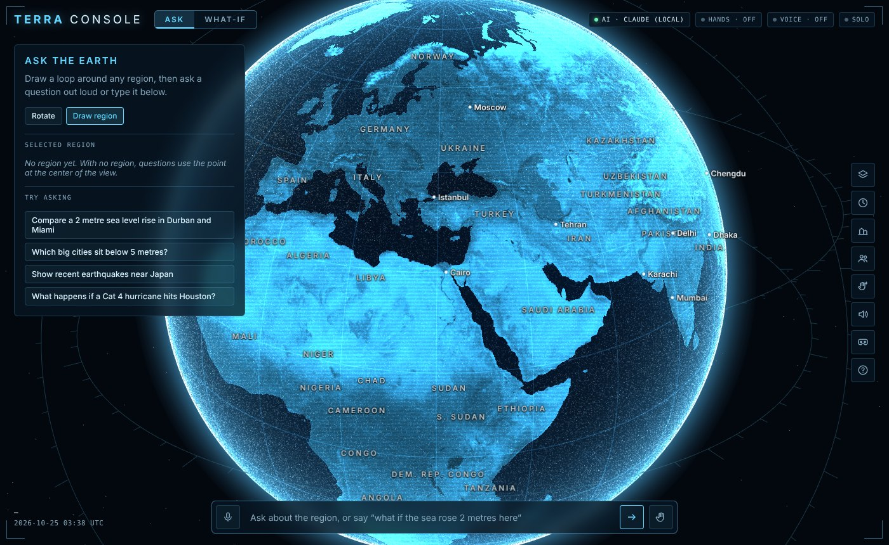
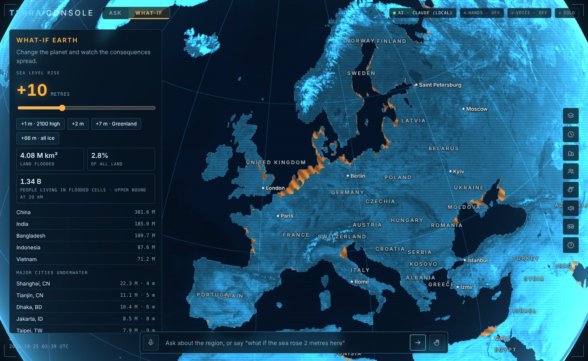

# Terra Console

**A holographic Earth you can question and change.** Point at any place on the planet with your mouse, your hands or your voice, ask what's there, then ask "what if?" and watch floods, hurricanes, eruptions and fires play out with real physics on real data.

**[▶ Live demo](https://adikarkm.github.io/terra-console/)**: runs in the browser with streamed satellite imagery and offline analysis (AI answers and live feeds need the local server below).



It has two modes that share one globe:

- **Ask the Earth**: draw a loop around any region and ask a question. An AI agent plans the work, calls data tools (terrain, flood model, cities, population, live earthquakes, NASA events, World Bank indicators), draws layers on the globe step by step, and narrates what it is doing. A fact-checker traces every number in the answer back to the tool call that produced it.
- **What-If Earth**: change the planet and watch the consequences. Raise the sea with a Priority-Flood model, spin up hurricanes steered by the wind field, erupt volcanoes and start wildfires whose ash and smoke drift with the winds.

The two modes hand off to each other: ask *"what if the sea rose 2 metres here?"* and the console jumps into the simulation with your region loaded.



## Engineering highlights

- **Planet-scale rendering:** satellite imagery and 3D terrain stream as tiles from the whole globe down to street level, on the true WGS84 ellipsoid (switching from a sphere fixed a misalignment of up to 21 km). Failed tiles retry and fall back to a built-in image, so the map never shows holes.
- **Simulation on the GPU and in WebAssembly:** a Priority-Flood algorithm written in AssemblyScript runs in a Web Worker (~200 ms for the whole planet); a shallow-water storm-surge model runs as WebGPU compute shaders, with a CPU fallback that is tested to agree with it; 1 million wind particles animate on the GPU.
- **Validated against history:** the hurricane model is calibrated on 50 years of real Atlantic tracks (NOAA HURDAT2) and beats a persistence baseline by 6–19% on held-out seasons. 50-member ensembles give strike probabilities by city.
- **Grounded AI agent:** a multi-step tool-calling loop (17 tools) that works with Claude or free models through OpenRouter, using one adapter that translates between the two API formats. Answers show where each number came from.
- **New ways to interact:** webcam hand tracking, a gesture classifier you train in the browser (a small neural network, about 1 s to train), voice commands with a wake word, "point-and-say" ("put a volcano *here*"), WebXR headsets, Looking Glass and physical sphere displays, multi-user rooms and procedural spatial audio.
- **Tested:** physics and unit tests, plus a 21-check end-to-end suite in headless Chromium (WebGL and WebGPU) against a mock backend that simulates flaky tile servers and a scripted AI.

**Tech:** JavaScript (ES modules), three.js, 3d-tiles-renderer, WebGPU (WGSL), WebAssembly (AssemblyScript), Web Workers, MediaPipe, Web Speech and Web Audio APIs, WebXR, Node.js with WebSockets, esbuild, Playwright.

**How it was built:** I designed and directed this project and built it with Claude (Anthropic's AI) as a coding partner.

## What's in it

| Area | Feature |
|---|---|
| Globe | **Streams satellite imagery and 3D terrain as tiles**, from the whole planet down to street level (~0.5 m imagery in cities, ~30 m terrain), on the true WGS84 Earth shape; tilt toward the horizon; place names from countries down to neighbourhoods (49,000 places); five basemaps (satellite, Sentinel-2, streets, topographic, night lights); hologram from afar fading to real imagery up close; floods computed against the detailed terrain |
| Input | Mouse, touch, webcam hand tracking (MediaPipe), custom gestures you train yourself, voice commands with an optional **"Terra" wake word**, **point-and-say** ("put a volcano *here*" resolves to where you pointed as you spoke), WebXR hands and controllers |
| Displays | Browser, VR/AR headsets, **Looking Glass** holographic displays, **physical spheres** (fisheye and equirectangular output) |
| Ask | Agentic tool loop over real data (17 tools), GeoJSON + style layers, data-derived layers, step narration, spoken answers, **a fact-checker that traces every number to the tool call that produced it** (tap a number to see its source) |
| What-If | WebAssembly Priority-Flood (AssemblyScript) in a Web Worker; **WebGPU shallow-water surge model** on high-resolution terrain tiles (CPU fallback); wind field (live GFS or climatology) with **1 million GPU particles**; hurricanes **calibrated on 50 years of real tracks** with land decay and surge risk; **50-member ensembles** with strike probabilities; Lagrangian ash and smoke plumes; wind-driven fire perimeters; meteor impacts |
| Exposure | A global **population surface** (GeoNames towns + World Bank national totals, dasymetric) so floods report people affected, by country |
| History | Replay any Atlantic hurricane 1975–2024 against the model; held-out forecast skill vs persistence |
| Live | Active hurricanes with NHC forecast cones, NASA FIRMS fires, USGS earthquakes |
| Time | Sea level scrubbing 1900–2150 under IPCC AR6 scenarios; NASA GIBS satellite imagery compare with a swipe divider |
| Ground view | Street-level view of a spot with the simulated water depth, fire and storm conditions, on a real Gaussian Splat capture you load or Google Photorealistic 3D Tiles |
| Together | Multi-user rooms: live cursors and hands drawn as beams on the globe, shared regions, answers and simulations |
| Sound | Procedural spatial audio: hurricane wind, fire crackle, volcanic rumble, surf over flooded coasts, panned by where they are relative to your cursor or hand |

## Running it

### 1. Built-in mode (no setup)
Open `dist/index.html` directly in Chrome or Edge. The globe, both modes, the flood model, storms, the timeline, layers and sound all work with the built-in data. Streamed imagery, live feeds and AI answers need the local server below.

### 2. Local server (everything)
Requirements: Node 18+. Python 3 with numpy, scipy and Pillow only if you want to rebuild the data.

```bash
npm install
cp .env.example .env        # add a free OPENROUTER_API_KEY (or ANTHROPIC_API_KEY) for AI answers
npm run build               # builds dist/index.html (data is prebuilt)
npm start                   # http://localhost:3000
```

Open http://localhost:3000 in Chrome or Edge, allow the camera (hand button) and microphone (mic button).

#### Free AI with OpenRouter
1. Sign up at https://openrouter.ai (no card needed) and create a key at https://openrouter.ai/keys.
2. Open `.env` in the project folder (Notepad is fine) and paste it: `OPENROUTER_API_KEY=sk-or-v1-...`
3. Restart `npm start`. The console prints `AI: OpenRouter (openrouter/free)` and the status chip shows **AI · OpenRouter (local)**.

The free tier allows about 20 requests a minute and 50 a day (1000 a day after a one-time $10 credit purchase). A question takes roughly 3–8 requests, so expect around 8–15 questions a day. When the limit is hit, the console says so and answers with offline analysis. Details: [docs/AI.md](docs/AI.md).

Optional:
- `npm test` runs the physics, unit and end-to-end suites (end-to-end needs Python Playwright).
- `npm run calibrate` refits the hurricane model to the historical tracks and reports skill.
- `npm run fetch-raw && npm run prepare-data` rebuilds every dataset from source.
- Add `FIRMS_MAP_KEY` to `.env` for live fires.
- Headsets and phones need HTTPS: see [docs/XR.md](docs/XR.md).

## Controls at a glance

| Hands (webcam) | Action |
|---|---|
| Open palm, move | Spin the globe |
| Pinch and drag | Draw a region (Ask) · draw a storm push or grab the globe (What-If) |
| Pinch on a button or slider | Press it / slide it |
| Two hands apart / together | Zoom |
| Fist, up / down | Raise / lower the sea (What-If) |
| Peace sign, hold | Switch mode |
| Your trained gestures | Whatever you bound them to |

| Voice or text | Action |
|---|---|
| "Go to Lagos" | Fly there |
| "What if the sea rose 3 metres" | Jump into the flood simulation |
| "Hurricane category 4 near Houston" | Spin up a steered storm |
| "Show me this region in 2000 vs 2026" | Satellite swipe compare |
| "Show the winds" / "true colour" / "ask mode" | Layers and modes |
| Anything else | Ask the agent |

Mouse: drag to spin or draw with the active tool, Shift-drag to draw a region from any tool, scroll to zoom, right-drag or Ctrl-drag to tilt (close to the ground), PageUp/PageDown to tilt, `+`/`-` to zoom, `/` focuses the command bar. Full reference: [docs/INTERACTION.md](docs/INTERACTION.md).

## Project layout

```
src/
  main.js              bootstrap and wiring
  state.js             shared state + event bus
  globe/               three.js scene, shaders, overlays, raster layers
  data/                DEM loader, cities and countries (+ generated data)
  sim/                 flood engine (Wasm worker), wind field, storms, hazards
  modes/               Ask the Earth, What-If Earth
  ai/                  agent orchestrator, tools, layer composition
  input/               pointer, hands, gesture classifier, voice, commands
  time/                IPCC scenarios, timeline and GIBS compare
  collab/              multi-user rooms (artifact rooms or WebSockets)
  xr/                  WebXR session, hand grab/scale, floating panel
  ground/              ground view: Gaussian Splats, Google 3D Tiles, effects
  audio/               procedural spatial soundscape
  ui/                  gesture trainer
  regional/            high-resolution terrain, WebGPU/CPU shallow-water model, surge patch
  live/                live hazards layer
  display/             spherical display output
  index.src.html       page markup and styles
wasm/flood.ts          Priority-Flood + region statistics (AssemblyScript)
server/server.js       local server: Claude proxy, live data, imagery, rooms
tools/                 data preparation, storm calibration
tests/                 physics, unit and end-to-end tests
assets/                earth.jpg, dem.png
docs/                  architecture, simulation, AI, interaction, XR, data, roadmap
```

## Documentation

- [Architecture](docs/ARCHITECTURE.md) — modules, data flow, transports
- [Simulation](docs/SIMULATION.md) — Priority-Flood, the elevation model, winds, storms, plumes, fire, impacts
- [AI agent](docs/AI.md) — orchestrator, tools, layer spec, adding tools
- [Interaction](docs/INTERACTION.md) — gestures, the trainer, voice, XR, sound
- [XR setup](docs/XR.md) — Quest and Vision Pro
- [Collaboration](docs/COLLABORATION.md) — the room protocol
- [Data and licences](docs/DATA.md)
- [Testing](docs/TESTING.md) — what is verified and how
- [Roadmap and known limits](docs/ROADMAP.md)

## Honest limits

This is an exploration and communication tool, not a hazard map. The global elevation grid is ~20 km; the regional surge model uses terrain tiles down to ~30 m but no levees or drainage. People counts at 20 km are an upper bound (everyone in a cell the sea reaches). Coastal city elevations come from a surveyed table for well-known cities and a ~6 m estimate elsewhere (marked `~`). Storm, fire and plume models are simplified physics meant to show how winds shape outcomes. Details in [docs/SIMULATION.md](docs/SIMULATION.md).

## Licence

MIT for the code (see [LICENSE](LICENSE)). Data and imagery carry their own licences, listed in [docs/DATA.md](docs/DATA.md).
