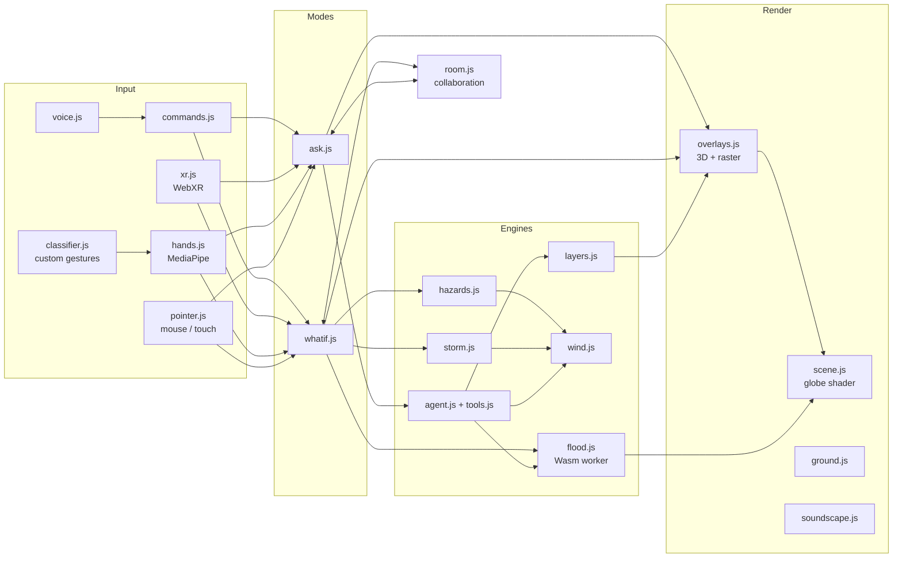

# Architecture

Terra Console is a single-page app bundled by esbuild in two forms from the same source: a code-split web build (`dist/index.html` plus hashed scripts and textures) for the local server and GitHub Pages, and one self-contained HTML file (`dist/terra-console-offline.html`, and `dist/artifact.html` for publishing) with three.js, the libraries, data, textures and the WebAssembly kernel inlined.

## Module map

### The streaming globe (`globe/stream.js`, `globe/placelabels.js`)

The globe is built from tiles like a web map. 3d-tiles-renderer's `TerrariumMeshPlugin` generates a quadtree of terrain meshes from Terrarium elevation tiles (displaced on the GPU, relief-shaded with a bump map) and drapes an `XYZTilesOverlay` of basemap imagery on them. Tiles are chosen each frame by screen-space error, so the view loads ~20–40 tiles at the detail it needs; the camera can descend from 20,000 km to ~400 m above the terrain and tilt up to 77°.

- **Earth shape.** Tiles sit on the WGS84 ellipsoid (scaled to equatorial radius 1). `ll2v`/`v2ll` use geodetic latitude on the same ellipsoid, and the built-in globe, the regional surge patch and every overlay use them, so imagery, floods, markers and labels line up to the metre.
- **Compositing.** Each tile material is patched (`onBeforeCompile`) to compute its geodetic lat/lon from position and apply the hologram tint, the flood and the data-layer raster. Up close, floods use the tile's own terrain height (~30 m) gated by the global Priority-Flood connectivity; coastlines in hologram mode come from the tile's bathymetry.
- **Depth.** A logarithmic depth buffer (custom shaders include the logdepth chunks) and an altitude-dependent near plane keep precision from orbit to street level. Overlays scale toward the ground as the camera descends; the atmosphere shell and console rings fade out.
- **Place names.** 49,025 GeoNames places (≥ 5,000 people) in 2° buckets. Every 160 ms the visible candidates above an altitude-dependent population threshold are projected and placed largest-first without overlap; country names show from orbit.
- **Sources.** Through the local server (`/api/tiles/<basemap>/z/x/y`, `/api/terrain/z/x/y.png`, cached in memory) or directly from the providers when the page is opened another way. The published artifact can't load outside images, so it keeps the built-in 4096 × 2048 image and limits zoom.

### Added engines

| Module | Role |
|---|---|
| `regional/terrain.js` | builds high-resolution grids from Terrarium tiles (or the global DEM) |
| `regional/swe.js` | local inertial shallow-water solver: WebGPU (WGSL) and CPU worker, plus regional Priority-Flood |
| `regional/regional.js` | surge UI, curved high-resolution patch on the globe, headless runs for the agent |
| `sim/windmodel.js` / `sim/windgpu.js` | wind sampling (pure) and 1 M GPU particles |
| `sim/validate.js` / `sim/ensemble.js` | historical replay and skill; perturbed ensembles |
| `ai/verify.js` | number provenance and critic prompt |
| `input/deixis.js` | point-and-say resolution |
| `live/live.js` | live hazards |
| `display/sphere.js` | spherical display output |
| `tools/node/*` | bundles engine modules for Node (calibration, tests) with a Node DEM loader |

`window.terra` exposes `{ S, G, regional, flood, runCommand }` in the browser console for debugging and scripting.

## Principles

**One action layer.** Every input source calls the same functions. `pointer.js` exposes `begin / move / end` taking screen coordinates or a lat/lon; the mouse, webcam hands and XR rays all use it. Voice and the text bar both go through `commands.js`. Remote peers apply the same state through `applySimState`.

**Event bus.** `state.js` holds shared state (`S`) and a tiny `on / emit` bus. Modules announce what happened (`sea`, `mode`, `region:changed`, `answer`, `sim:changed`, `hover`) and others react (collaboration, XR panel, sound, status chips). This keeps modules independent.

**Geo-anchored everything.** All overlays live under `G.globe`, the rotated group, so they turn with the planet. Points use `ll2v(lat, lon)`, which matches the UV layout of three.js `SphereGeometry`, so the texture, the DEM, the flood texture and the overlays line up exactly.

**Two kinds of overlay.** 3D objects (sprites, discs, tubes, arcs, labels) for points and lines; an equirectangular 2048×1024 canvas (`Raster`) for polygons and data gradients. The globe shader samples that canvas, so any GeoJSON polygon or per-cell gradient drapes onto the surface regardless of shape or size.

**Heavy compute off the main thread.** The flood kernel runs in a Web Worker created from a blob URL, with the Wasm bytes passed in. Rendering and MediaPipe stay smooth.

## The globe shader

`scene.js` samples four textures:

| Texture | Content |
|---|---|
| `dayTex` | Blue Marble true colour (or a GIBS image during time compare) |
| `altTex` | The comparison image for the swipe divider |
| `floodTex` | RGBA half floats: R = Priority-Flood spill level, G = elevation, B = surface class |
| `overlayTex` | The raster layer canvas |

A cell is drawn as flooded when `land && spill <= uSea`. Because the spill levels are precomputed, raising the sea is a uniform change and costs nothing; `S.seaShown` eases toward `S.sea` each frame so water visibly spreads. Linear filtering on the half-float texture smooths the flood contour between 20 km cells.

## Startup sequence

1. Decode the DEM PNG into `Float32Array` elevation and `Uint8Array` class arrays.
2. Build the scene, overlays, modes, wind and plume layers, pointer, timeline, ground view and trainer.
3. Start collaboration (auto-joins the artifact room when one is offered).
4. In parallel: start the flood worker (Priority-Flood runs once, ~200 ms) and probe for AI (`claude.use("sample")` and `/api/health`).
5. If the local server answered, fetch live winds and show named rooms.

## Transports

| Need | Published artifact | Local server |
|---|---|---|
| Claude | `sample` capability: Claude runs the tool loop and calls the page's tool functions | `/api/claude` proxy; the page runs the Messages API tool loop itself |
| Live data | not available | `/api/wind`, `/api/quakes`, `/api/events`, `/api/indicators`, `/api/gibs` |
| Rooms | `room` capability (everyone with the page) | WebSockets at `/ws?room=NAME` |
| Camera / microphone / XR | not available | browser permissions on localhost or HTTPS |

Each feature checks for its transport at runtime and degrades with a clear message rather than failing.

## Build

`build.mjs`:
1. compiles `wasm/flood.ts` with AssemblyScript (`--runtime stub -O3`, ~2 KB),
2. **single-file build**: bundles `src/main.js` with esbuild (IIFE, minified, ASCII output; images as data URLs, Wasm as bytes, JSON inline) into `dist/terra-console-offline.html` (opens from disk) and `dist/artifact.html` (body content for publishing),
3. **web build**: the same entry as ES modules with code splitting: `dist/index.html`, `app-[hash].js`, shared and lazy chunks `c-*-[hash].js`, textures in `dist/assets/` (hashed, served `immutable`). `index.html` preloads the elevation and population images and the entry's chunks so they download in parallel.

### Loading

What the first frame needs comes first; everything else arrives later or on demand:

| Item | Size (web build) | When |
|---|---|---|
| Entry script (three.js, app) | ~370 KB (~110 KB gzip) | immediately |
| Elevation (lossless WebP, decodes to the same pixels as `dem.png`) | 398 KB | preloaded, before the first frame |
| World image preview (1024 px WebP, inlined) | 44 KB | first frame |
| World image (4096 px WebP) | 628 KB | swapped in when it arrives |
| Population and countries raster (lossless WebP) | 636 KB | in the background; the flood engine waits for it |
| Town names (49,000) | 1.6 MB (~400 KB gzip) | 0.3 s after start; cities over 100k are labelled until then |
| Storm archive | lazy chunk | a few seconds after start, or when the history panel is used |
| Gaussian Splat renderer | ~240 KB | when a capture is opened |

`tests/perf/load.py` measures it on a throttled connection (headless Chromium, gzip like GitHub Pages): first globe on screen went from 8.2 s to 2.9 s at 5 Mbit/s and from 3.2 s to 1.2 s at 20 Mbit/s compared with the previous single 7.4 MB file.
